# 零基礎做遊戲海洋：範例專案

YouTube 教學系列「零基礎做遊戲海洋」每一集的 Godot 範例專案。每集一個資料夾，每個資料夾都是一個可以直接打開的 Godot 專案。

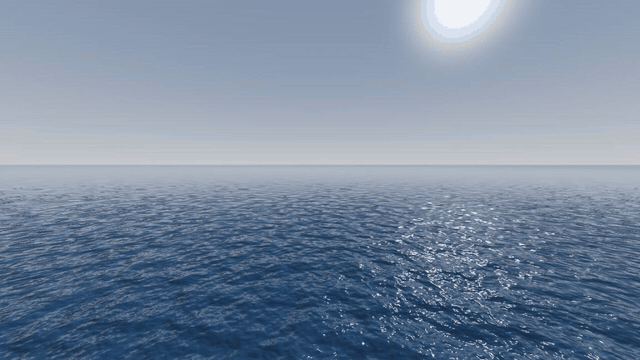

## 怎麼使用

1. 下載這個 repo：按右上角綠色的 **Code** → **Download ZIP**，解壓縮。
2. 打開 Godot 4.7 以上（標準版），在專案管理員按「**匯入**」。
3. 選你要的那一集資料夾裡的 `project.godot`，例如 `ep01-first-sea/project.godot`。
4. 打開後按 **F5** 執行。

需要 Godot 4.7 以上，渲染器使用 Forward+（需要支援 Vulkan 的顯示卡）。

## 各集範例

| 集 | 資料夾 | 內容 | 影片 | 文章 |
| --- | --- | --- | --- | --- |
| 0 | — | 總覽：遊戲裡的海是怎麼做出來的（沒有範例專案） | [YouTube](https://www.youtube.com/watch?v=GWMWLkf4mzU) | [部落格](https://dev-mojo.blogspot.com/2026/11/godot-crest.html) |
| 1 | [ep01-first-sea](ep01-first-sea/) | 裝好 Godot，不寫程式，搭出第一片會動的海：天空、太陽、海面材質、法線貼圖、AnimationPlayer | [YouTube](https://www.youtube.com/watch?v=GptVdkdfVzY) | [部落格](https://dev-mojo.blogspot.com/2026/11/1-godot.html) |
| 2 | [ep02-buoys](ep02-buoys/) | 第一次寫程式：用 GDScript 和 sin 波，讓 400 顆浮標排出一片會起伏的海 | 即將推出 | 即將推出 |
| 3 | [ep03-first-shader](ep03-first-shader/) | 第一個 shader：把浪搬進顯示卡，海面的顏色跟著浮標的浪起伏；附 8 個 shader 小範例 | 即將推出 | 即將推出 |
| 4 | [ep04-vertex-waves](ep04-vertex-waves/) | 把平面推成浪：用 vertex() 推動頂點，浮標浮在真正起伏的浪上 | 即將推出 | 即將推出 |
| 5 | [ep05-gerstner](ep05-gerstner/) | 尖尖的浪：三個 Gerstner 波疊在一起，浮標跟著水畫圓 | 即將推出 | 即將推出 |
| 6 | [ep06-normals](ep06-normals/) | 讓浪有立體感：算出法線，浪有亮面和暗面；附光照與陰影實驗室 | 即將推出 | 即將推出 |
| 7 | [ep07-fresnel](ep07-fresnel/) | 為什麼遠處的海像鏡子：Fresnel 效果，近處透藍、遠處反射天空；附反射實驗室 | 即將推出 | 即將推出 |

## 第 1 集：搭出第一片海

只用 Godot 內建功能，沒有任何程式碼。場景 `my_ocean.tscn` 裡有五個節點：

| 節點 | 用途 | 主要設定 |
| --- | --- | --- |
| WorldEnvironment | 天空、霧、色調 | ProceduralSkyMaterial；霧 Density 0.0012、Sky Affect 0；Tonemap Filmic |
| Sun（DirectionalLight3D） | 太陽 | Rotation X -30°、Y 150° |
| Sea（MeshInstance3D） | 海面 | PlaneMesh 2000 × 2000；StandardMaterial3D：顏色 #0b3954、Roughness 0.05、NoiseTexture2D 法線貼圖、UV1 Scale 100 |
| Camera3D | 相機 | 位置 Y 5、往下 4°、Far 10000 |
| AnimationPlayer | 讓波紋流動 | 動畫 `flow`：10 秒循環，材質 UV1 Offset 從 (0, 0, 0) 到 (1, 0, 0) |

## 第 2 集：用 400 顆浮標做出第一道浪

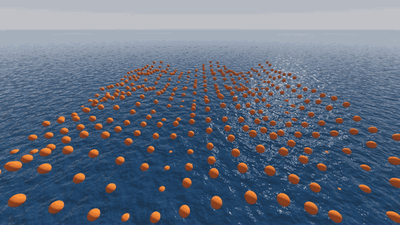

接續第 1 集的海，加上一個 `Buoys` 節點和腳本 `buoys.gd`（每行都有中文註解）：

- `_ready()`：用兩層 for 迴圈排出 20 × 20 顆浮標
- `_process()`：每一幀依照時間更新每顆浮標的高度
- `sine_wave()`：一個 sin 波（振幅、波長、速度）
- `wave_height()`：把三個方向、大小不同的波加起來

選取 Buoys，可以在屬性檢視器調整 Grid Size、Spacing、Amplitude、Wavelength、Speed。

### 加碼場景

| 場景 | 內容 |
| --- | --- |
| `main.tscn` | 主教學：浮標加三個 sin 波（`buoys.gd`） |
| `wave_lab.tscn` | 造浪實驗室（`wave_lab.gd`）：選取 WaveLab，在屬性檢視器切換 Mode（SINE、SHARP 尖峰波、GERSTNER、NOISE 雜訊、RIPPLE 圓形漣漪），打開 Show Lines 用線段畫出波形，調 Line Samples 看取樣點數的差別 |
| `wireframe.tscn` | 重現第 0 集那張會動的網子：橫向、直向都畫線段，深藍色背景加霧 |

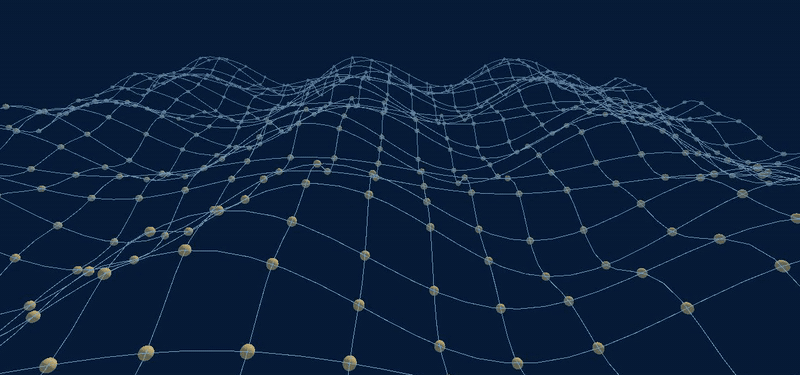

要打開加碼場景：在 Godot 左下角檔案系統雙擊 `wave_lab.tscn` 或 `wireframe.tscn`，再按 **F6** 執行目前的場景。

## 第 3 集：第一個 Shader，讓顯示卡畫海

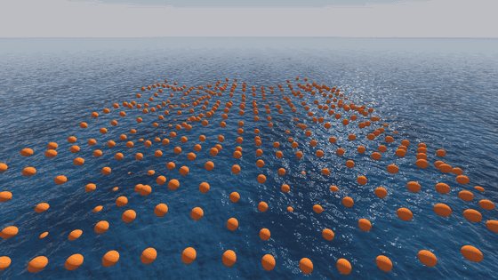

接續第 2 集的浮標，海面換成自己寫的 shader `water.gdshader`（每行都有中文註解）：

- `sine_wave()`、`wave_height()`：和第 2 集 `buoys.gd` 一模一樣的三個 sin 波，翻譯成 shader 語言
- `fragment()`：把 UV 換算成公尺、對齊浮標方陣，浪越高顏色越亮
- 細小的波紋用 `TIME` 讓法線貼圖滑動，不需要 AnimationPlayer

選取 Sea，展開 Material Override 的 **Shader Parameters**，可以調顏色、浪的大小和波紋。

| 檔案 | 內容 |
| --- | --- |
| `main.tscn` | 主教學：浮標加上 shader 海面 |
| `water.gdshader` | 完成的海面 shader |
| `steps/water_A` 到 `water_E` | 文章裡一步一步的版本：單色 → UV → TIME → 一道浪 → 三個波。把 Sea 材質的 Shader 換成其中一個，就能看到那一步的樣子 |
| `shader_gallery.tscn` | 小教室：8 個 shader 小範例排在一起 |
| `examples/01` 到 `08` | 單色、UV 漸層、隨時間變色、棋盤格、圓形漣漪、邊緣發光、溶解消失、頂點擺動 |
| `classroom/01_solid.tscn` 到 `08_wobble.tscn` | 小教室影片用的特寫場景：一個場景只放一個範例，按 F6 單獨執行 |

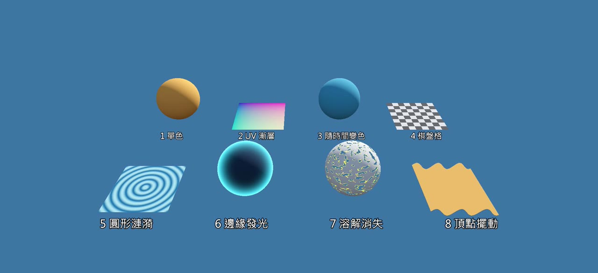

要打開範例展示：在 Godot 左下角檔案系統雙擊 `shader_gallery.tscn`，再按 **F6** 執行目前的場景。

### 小教室：8 個範例怎麼做、為什麼這樣做

第 3 集另外有一支小教室影片，一個一個講這 8 個範例。想單獨看某一個，就打開 `classroom/` 裡對應的場景，例如 `classroom/07_dissolve.tscn`，按 **F6** 執行。改 `examples/` 裡的 shader，存檔後畫面會馬上更新，可以邊改數字邊看效果。

## 第 4 集：把平面推成浪

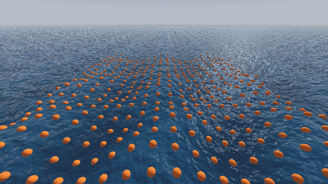

上一集的浪只是顏色，這一集用 `vertex()` 把海面真的推起來：

- 海面 `Sea` 是 1000 × 1000 公尺的 PlaneMesh，Subdivide Width / Depth 都是 999，每 1 公尺一個頂點
- `water.gdshader` 的 `vertex()` 用和浮標一樣的三個 sin 波推動每個頂點，再用 `varying` 把高度交給 `fragment()` 決定顏色
- 浪用世界座標算（`MODEL_MATRIX * vec4(VERTEX, 1.0)`），海面移動時浪會留在原地
- `Buoys` 節點放在 y = 0，浮標剛好一半在水裡，證明 GDScript 和 shader 算的是同一個浪

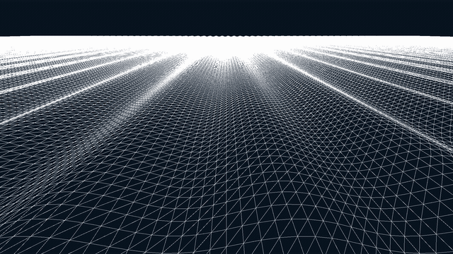

| 檔案 | 內容 |
| --- | --- |
| `main.tscn` | 完成的場景 |
| `water.gdshader` | 完成的 shader（每行都有中文註解） |
| `steps/water_A` | 每個頂點都加 2：整片海升高 |
| `steps/water_B` | 用 sin 推頂點（PlaneMesh 細分改成 0 和 999 比比看） |
| `steps/water_D` | 換成三個波，和浮標對齊（用本地座標 VERTEX） |
| `steps/water_E` | 用 varying 把高度交給 fragment() |

想看某一步的樣子：選取 `Sea`，在 Material Override 的 Shader 欄位換成 `steps/` 裡的檔案。

**自己試試本地座標和世界座標的差別**：把 Shader 換成 `steps/water_E.gdshader`（本地座標），再把 `Sea` 的 Position X 改成 8，按 F5，浮標就對不上了；換回 `water.gdshader`（世界座標），浮標又回到水面上。試完記得把 Position X 改回 0。

看網格：3D 畫面左上角的「透視」選單 →「顯示線框」。

## 第 5 集：尖尖的浪：Gerstner 波

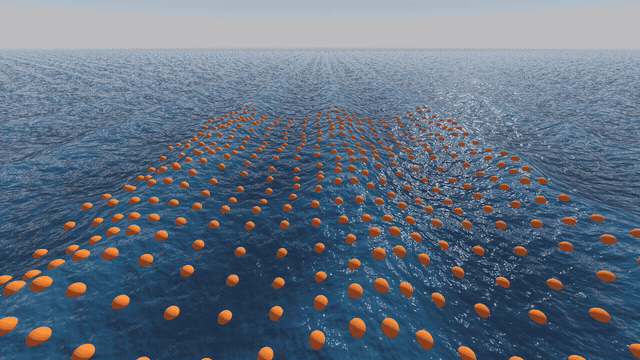

真實的海浪浪峰尖、浪谷平，因為水不只上下動，還在畫圓。

- `water.gdshader` 的 `gerstner()`：用方向（向量、`normalize`、`dot`）、陡度、波長算出一個波的位移；速度用深水波的公式 `sqrt(9.8 / k)`
- 三個波放在 `uniform vec4 waves[3]`，用 for 迴圈加起來
- `buoys.gd` 用同一個公式、同一組數字，浮標會跟著水前後擺動

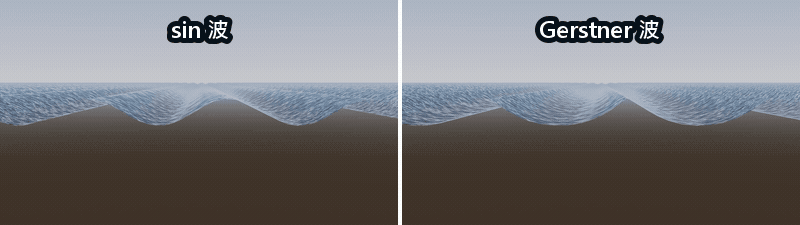

| 檔案 | 內容 |
| --- | --- |
| `main.tscn` | 完成的場景 |
| `water.gdshader` | 完成的 shader（每行都有中文註解） |
| `buoys.gd` | 浮標也用 Gerstner 波 |
| `steps/water_A0` | 對照用：只有上下的 sin 波 |
| `steps/water_A` | 一個 Gerstner 波：多了前後 |
| `steps/water_B` | 換方向：向量、normalize、dot |
| `steps/water_C` | 速度從物理來：`sqrt(9.8 / k)` |

**三個波的數字在哪裡**：Godot 的 uniform 陣列不能在 shader 裡寫預設值，所以數字填在 `Sea` 的材質裡。選取 `Sea` → Material Override → Shader Parameters → **Waves**，每個 vec4 是（方向 x、方向 y、陡度、波長）。改了這裡，也要把 `Buoys` 的 **Waves** 改成一樣，浮標才會浮在浪上。

陡度加起來最好不要超過 1，不然浪峰會打結。

## 第 6 集：讓浪有立體感：法線與光照

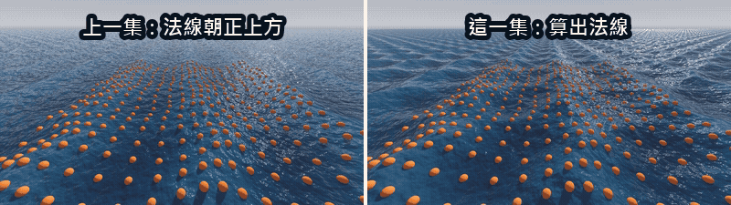

上一集的浪推起來了，看起來卻是平的：光照要靠「法線」（表面朝向哪裡），頂點被推動之後法線還是朝正上方。

- `water.gdshader` 的 `vertex()`：「看看鄰居」，往 x、z 各走 `neighbor_step`（0.1 公尺），算出那裡的水被推到哪裡
- 從這裡指向鄰居的兩個方向就是兩個斜面，`cross(along_z, along_x)` 外積再 `normalize`，交給 `NORMAL`
- 三個波的數字和第 5 集一樣（`Sea` 材質的 **Waves** 和 `Buoys` 的 **Waves**）

| 檔案 | 內容 |
| --- | --- |
| `main.tscn` | 完成的場景（Sun 打開陰影） |
| `water.gdshader` | 完成的 shader（每行都有中文註解） |
| `buoys.gd` | 第 5 集的 Gerstner 浮標 |
| `steps/water_A` | 把法線畫成顏色：還沒算，整片一個顏色 |
| `steps/water_B` | 把算出來的法線畫成顏色 |
| `steps/water_analytic` | 補充：直接用公式（偏微分）算法線，結果幾乎一樣、只算 1 次浪 |
| `lighting_lab.tscn`、`lighting_lab.gd` | 小教室：光照與陰影實驗室 |

### 小教室：光照與陰影實驗室

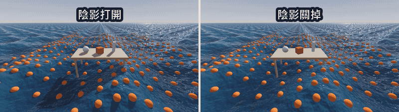

在檔案系統雙擊 `lighting_lab.tscn`，選取最上面的 **LightingLab** 節點，屬性檢視器裡就能調 Sun Height（太陽高度）、Sun Direction（方向）、Energy（亮度）、Color（顏色）、Shadows（陰影）。腳本有 `@tool`，**不用按執行**，拉數字畫面就會馬上變。

打勾 **Auto Day**，太陽會從日出走到日落，顏色和影子一起變。它在編輯器裡也會一直跑，看完記得把勾拿掉。

## 第 7 集：為什麼遠處的海像鏡子：Fresnel 與天空反射

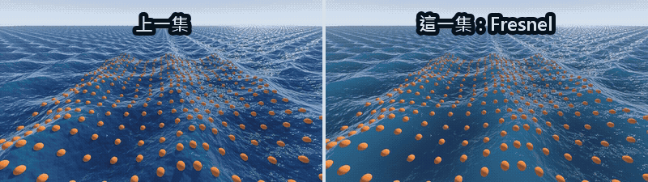

往下看水是透明的藍，往遠處看海面像鏡子：水面反射多少，要看從什麼角度看。往下看只反射 2%，貼著水面看幾乎全部反射，這叫 Fresnel 效果。

- `water.gdshader` 的 `fragment()`：`dot(NORMAL, VIEW)` 是「正對著看的程度」，`0.02 + 0.98 * pow(1.0 - facing, 5.0)` 算出反射多少
- 水本身的顏色放在 `EMISSION`，乘上 `1.0 - fresnel`：反射越多，看到的水越少
- 天空的反射和太陽的亮點交給 Godot：`SPECULAR = 0.35` 剛好是水（正對著看反射 2%），`ROUGHNESS` 0.05
- `main.tscn` 的天空調藍、地平線調亮：遠處的海反射的就是天空

| 檔案 | 內容 |
| --- | --- |
| `main.tscn` | 完成的場景 |
| `water.gdshader` | 完成的 shader（每行都有中文註解） |
| `buoys.gd` | 第 5 集的 Gerstner 浮標 |
| `steps/water_A` | 把 Fresnel 畫成黑白：近處黑，遠處白 |
| `steps/water_B` | 用 `mix` 把水的顏色和一個天空色混在一起 |
| `reflection_lab.tscn`、`reflection_lab.gd` | 小教室：反射實驗室 |

### 小教室：天空和三個材質旋鈕

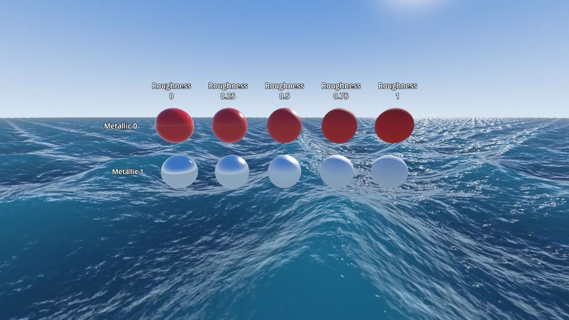

- **天空在哪裡改**：選取 `WorldEnvironment`，展開 Environment → Sky → Sky Material。Sky 段的 Horizon Color 就是遠處的海反射的顏色，改成橘色試試看。
- **材質的三個反射旋鈕**：雙擊 `reflection_lab.tscn`，選取一顆球，展開 Surface Material Override 裡的材質，改 Roughness（多粗糙）、Metallic（是不是金屬）、Specular（反射多強）。
- **反射實驗室**：選取最上面的 **ReflectionLab** 節點，在屬性檢視器改 Sky Top、Sky Horizon、Sun Height、Sea Roughness、Sea Specular。腳本有 `@tool`，**不用按執行**，改數字畫面就會馬上變。

## 授權

範例專案以 MIT 授權釋出，可以自由使用、修改，也可以用在你自己的遊戲裡。
