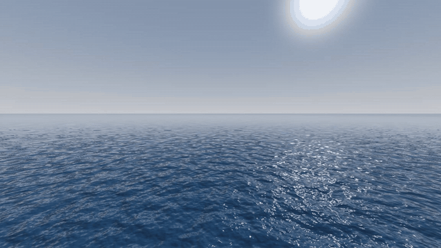
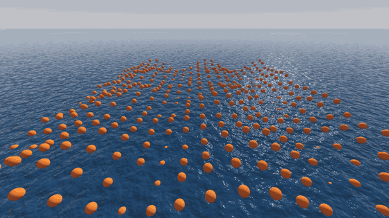
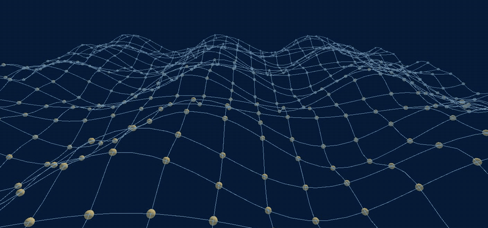
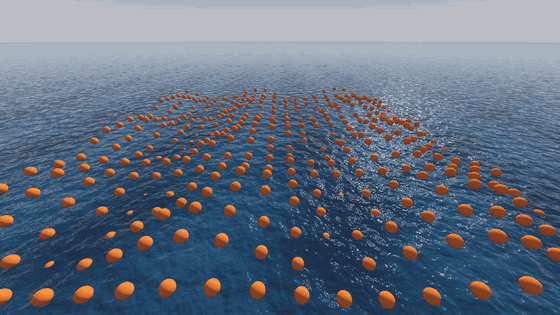
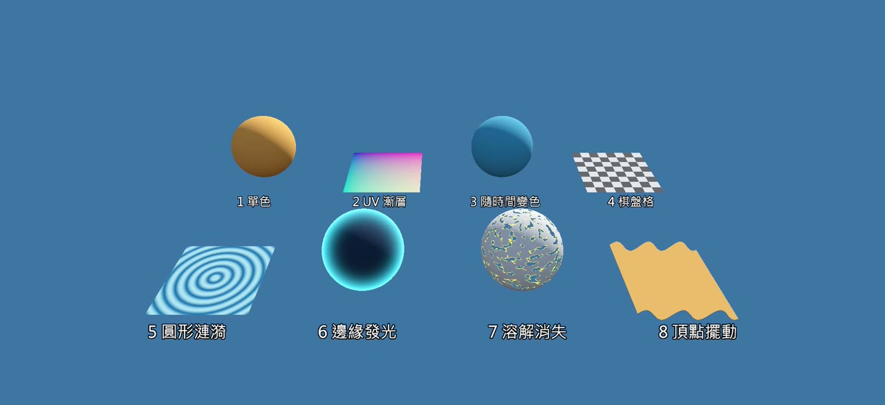

# 零基礎做遊戲海洋：範例專案

YouTube 教學系列「零基礎做遊戲海洋」每一集的 Godot 範例專案。每集一個資料夾，每個資料夾都是一個可以直接打開的 Godot 專案。

## 怎麼使用

1. 下載這個 repo：按右上角綠色的 **Code** → **Download ZIP**，解壓縮。
2. 打開 Godot 4.7 以上（標準版），在專案管理員按「**匯入**」。
3. 選你要的那一集資料夾裡的 `project.godot`，例如 `ep01-first-sea/project.godot`。
4. 打開後按 **F5** 執行。

需要 Godot 4.7 以上，渲染器使用 Forward+（需要支援 Vulkan 的顯示卡）。

## 各集範例

| 集 | 資料夾 | 內容 | 影片 | 文章 |
| --- | --- | --- | --- | --- |
| 0 | — | 總覽：遊戲裡的海是怎麼做出來的（沒有範例專案） | [YouTube](https://www.youtube.com/watch?v=GWMWLkf4mzU) | [部落格](https://dev-mojo.blogspot.com/2026/11/godot-crest.html) |
| 1 | [ep01-first-sea](ep01-first-sea/) | 裝好 Godot，不寫程式，搭出第一片會動的海：天空、太陽、海面材質、法線貼圖、AnimationPlayer | [YouTube](https://www.youtube.com/watch?v=GptVdkdfVzY) | 即將推出 |
| 2 | [ep02-buoys](ep02-buoys/) | 第一次寫程式：用 GDScript 和 sin 波，讓 400 顆浮標排出一片會起伏的海 | 即將推出 | 即將推出 |
| 3 | [ep03-first-shader](ep03-first-shader/) | 第一個 shader：把浪搬進顯示卡，海面的顏色跟著浮標的浪起伏；附 8 個 shader 小範例 | 即將推出 | 即將推出 |

## 第 1 集：搭出第一片海

只用 Godot 內建功能，沒有任何程式碼。場景 `my_ocean.tscn` 裡有五個節點：

| 節點 | 用途 | 主要設定 |
| --- | --- | --- |
| WorldEnvironment | 天空、霧、色調 | ProceduralSkyMaterial；霧 Density 0.0012、Sky Affect 0；Tonemap Filmic |
| Sun（DirectionalLight3D） | 太陽 | Rotation X -30°、Y 150° |
| Sea（MeshInstance3D） | 海面 | PlaneMesh 2000 × 2000；StandardMaterial3D：顏色 #0b3954、Roughness 0.05、NoiseTexture2D 法線貼圖、UV1 Scale 100 |
| Camera3D | 相機 | 位置 Y 5、往下 4°、Far 10000 |
| AnimationPlayer | 讓波紋流動 | 動畫 `flow`：10 秒循環，材質 UV1 Offset 從 (0, 0, 0) 到 (1, 0, 0) |

## 第 2 集：用 400 顆浮標做出第一道浪

接續第 1 集的海，加上一個 `Buoys` 節點和腳本 `buoys.gd`（每行都有中文註解）：

- `_ready()`：用兩層 for 迴圈排出 20 × 20 顆浮標
- `_process()`：每一幀依照時間更新每顆浮標的高度
- `sine_wave()`：一個 sin 波（振幅、波長、速度）
- `wave_height()`：把三個方向、大小不同的波加起來

選取 Buoys，可以在屬性檢視器調整 Grid Size、Spacing、Amplitude、Wavelength、Speed。

### 加碼場景

| 場景 | 內容 |
| --- | --- |
| `main.tscn` | 主教學：浮標加三個 sin 波（`buoys.gd`） |
| `wave_lab.tscn` | 造浪實驗室（`wave_lab.gd`）：選取 WaveLab，在屬性檢視器切換 Mode（SINE、SHARP 尖峰波、GERSTNER、NOISE 雜訊、RIPPLE 圓形漣漪），打開 Show Lines 用線段畫出波形，調 Line Samples 看取樣點數的差別 |
| `wireframe.tscn` | 重現第 0 集那張會動的網子：橫向、直向都畫線段，深藍色背景加霧 |

要打開加碼場景：在 Godot 左下角檔案系統雙擊 `wave_lab.tscn` 或 `wireframe.tscn`，再按 **F6** 執行目前的場景。

## 第 3 集：第一個 Shader，讓顯示卡畫海

接續第 2 集的浮標，海面換成自己寫的 shader `water.gdshader`（每行都有中文註解）：

- `sine_wave()`、`wave_height()`：和第 2 集 `buoys.gd` 一模一樣的三個 sin 波，翻譯成 shader 語言
- `fragment()`：把 UV 換算成公尺、對齊浮標方陣，浪越高顏色越亮
- 細小的波紋用 `TIME` 讓法線貼圖滑動，不需要 AnimationPlayer

選取 Sea，展開 Material Override 的 **Shader Parameters**，可以調顏色、浪的大小和波紋。

| 檔案 | 內容 |
| --- | --- |
| `main.tscn` | 主教學：浮標加上 shader 海面 |
| `water.gdshader` | 完成的海面 shader |
| `steps/water_A` 到 `water_E` | 文章裡一步一步的版本：單色 → UV → TIME → 一道浪 → 三個波。把 Sea 材質的 Shader 換成其中一個，就能看到那一步的樣子 |
| `shader_gallery.tscn` | 小教室：8 個 shader 小範例排在一起 |
| `examples/01` 到 `08` | 單色、UV 漸層、隨時間變色、棋盤格、圓形漣漪、邊緣發光、溶解消失、頂點擺動 |

要打開範例展示：在 Godot 左下角檔案系統雙擊 `shader_gallery.tscn`，再按 **F6** 執行目前的場景。

## 授權

範例專案以 MIT 授權釋出，可以自由使用、修改，也可以用在你自己的遊戲裡。
